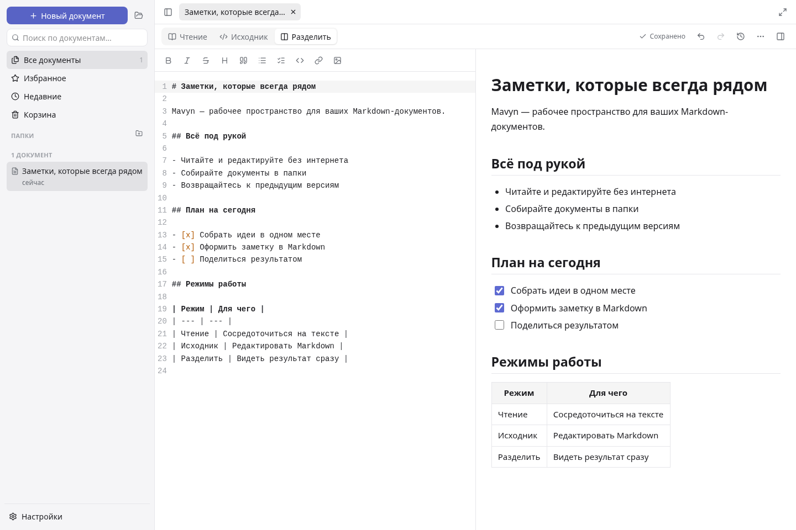

# Mavyn

Markdown-редактор с локальной библиотекой, работой без интернета и синхронизацией через собственный сервер. Windows, Linux, Android и веб; русский и английский интерфейс.

[Скачать](https://github.com/Velcheor137/Mavyn/releases/latest) · [Установка и запуск](docs/getting-started.ru.md) · [Руководство](docs/user/ru.md) · [Статус проекта](docs/status.md)
